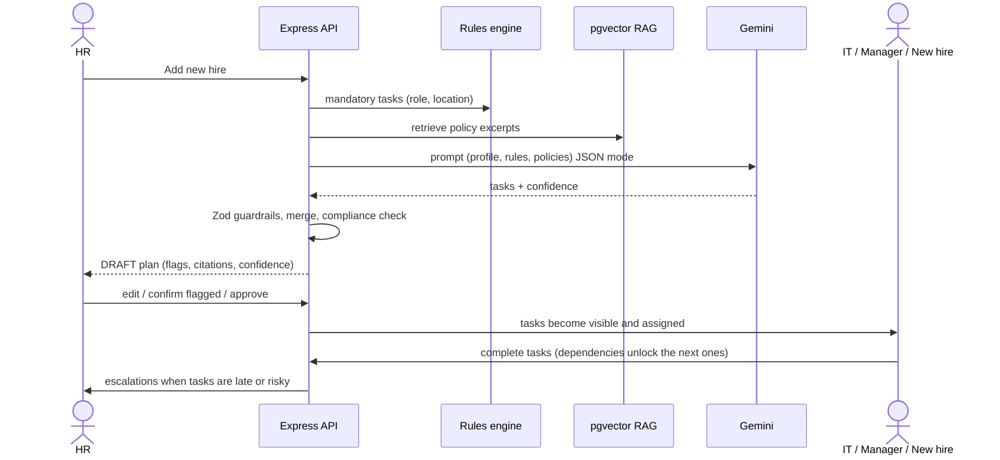
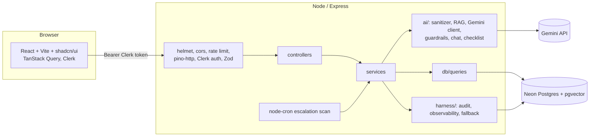

# Employee Onboarding Orchestrator

AI-assisted employee onboarding with a human in the loop. HR enters a new hire; the system drafts a location- and role-aware checklist (deterministic rules plus Gemini grounded in company policies), holds it as a **draft** until HR approves, then assigns, tracks and escalates the work. New hires get a policy chatbot that answers only from company documents, with citations.

> **AI harness principle:** the LLM is never trusted blindly. Everything it produces is validated, scored, logged and reviewable by a human; if the LLM fails, a deterministic fallback takes over.

## Problem and user journey

Onboarding is fragmented across HR, IT, Finance and managers. Checklists are generic (a Bangalore engineer and a New York sales rep get the same list), tasks fall through the cracks (laptop never ordered), legal paperwork differs per country (India: PAN/Aadhaar; US: W-4/I-9/SSN; Canada: SIN/TD1; UK: right-to-work, P45/NI) and nobody sees what is late until it is too late.



## Features

| # | Feature | Where |
|---|---|---|
| 1 | New hire intake (free-text role/location accepted) | `NewHireDialog`, `POST /api/employees` |
| 2 | Deterministic rules engine, 30 task templates | `rulesEngine.service.js`, `data/taskTemplates.json` |
| 3 | AI checklist: rules + RAG + Gemini JSON mode + guardrails + merge + confidence | `ai/checklistGenerator.js`, `taskGenerator.service.js` |
| 4 | RAG over pgvector (chunk, embed, store, cosine search) | `ai/ragPipeline.js`, `npm run ingest` |
| 5 | HR approval (draft, approve, reject, edit, add, delete, confirm) | `OnboardingDetail`, `/api/onboarding`, `/api/tasks` |
| 6 | Dependencies: cycle detection (Kahn), unblocking, state machine | `dependencyResolver.service.js` |
| 7 | Policy chatbot with citations, refusals, injection resistance | `ai/chatAssistant.js`, `ChatWidget` |
| 8 | Escalation engine (6 triggers) + cron | `escalation.service.js`, `jobs/escalationCron.js` |
| 9 | Immutable audit trail (DB trigger blocks UPDATE/DELETE) | `harness/auditLogger.js`, `AuditTimeline` |
| 10 | Fallback plan when the LLM fails | `harness/fallbackHandler.js` |
| 11 | Observability metrics and charts | `harness/observability.js`, `ObservabilityPage` |
| 12 | Role-based dashboards (HR, manager, employee) | `frontend/src/pages` |
| 13 | Manual eval script | `npm run eval` |

## Architecture



More detail (layers, data flow, state machines) in [docs/architecture.md](docs/architecture.md).

## Tech decisions

| Choice | Reason |
|---|---|
| Rules first, LLM second | Legal/mandatory tasks must never depend on a model. The LLM can enrich and add context but cannot remove or reschedule a rule task. |
| Zod guardrails on every LLM output | Fails closed: bad tasks are dropped and logged, bad responses trigger one correction retry and then the fallback. |
| pgvector on the same Neon DB | One datastore, SQL filtering by location scope, no extra service. |
| Custom RAG (no LangChain) | The pipeline is about 100 lines; fewer dependencies and easier to audit. |
| Clerk roles in `publicMetadata.role` | Auth and roles without building user management; scoping is enforced in SQL on the backend. |
| Neon WebSocket driver (`@neondatabase/serverless`) for Neon hosts, `pg` otherwise | Neon hosts connect over port 443, which works on networks that block outbound 5432. `DB_DRIVER` overrides the auto-detection. |
| Plain JavaScript (ES modules) | Required by the brief; Zod provides the runtime contracts. |

## Setup from a clean clone

Prerequisites: Node 20+, a Neon project, a Clerk application, a Google AI Studio API key.

### 1. Neon (Postgres + pgvector)
1. Create a project at neon.tech and copy the connection string (with `?sslmode=require`).
2. pgvector is available on Neon. The first migration runs `CREATE EXTENSION IF NOT EXISTS vector;` for you.

### 2. Clerk
1. Create an application, enable Email sign-in.
2. Copy the **Publishable key** and **Secret key**.
3. Roles live in **Users, your user, Public metadata**: `{ "role": "hr" }` (`hr`, `manager` or `employee`; a missing role means `employee`).
4. In development the top bar has a clearly marked **DEV ONLY** role switcher that updates this metadata for you, so a single account can demo all three views.
5. Employees are linked to their record by **matching the Clerk email to `employees.email`**. Managers are linked via the manager email entered on the hire.

### 3. Gemini
Create a key at aistudio.google.com. Model names change, so check the current docs and set `GEMINI_MODEL` and `GEMINI_EMBEDDING_MODEL` accordingly (defaults: `gemini-2.5-flash`, `gemini-embedding-001` at 768 dimensions).

### 4. Backend
```bash
cd backend
cp .env.example .env          # fill DATABASE_URL, CLERK_*, GEMINI_API_KEY
npm install
npm run db:migrate            # tables, pgvector, audit immutability trigger
npm run ingest                # embed policy documents (idempotent)
npm run seed                  # ~50 demo employees, no Gemini calls (idempotent, truncates)
npm run dev                   # http://localhost:8000  (Swagger UI at /docs)
```
Optional: `SEED_DEMO_EMAIL=you@example.com npm run seed` links your Clerk email to a demo manager's team and to a demo employee, so the Manager and Employee views are populated when you switch roles.

### 5. Frontend
```bash
cd frontend
cp .env.example .env          # VITE_CLERK_PUBLISHABLE_KEY, VITE_API_URL
npm install
npm run dev                   # http://localhost:5173
```

### Environment variables (`backend/.env`)

| Variable | Default | Purpose |
|---|---|---|
| `PORT` | 8000 | API port |
| `NODE_ENV` | development | `development` enables the dev role endpoint and `?simulate=` demo hooks |
| `DATABASE_URL` | required | Neon connection string |
| `CLERK_PUBLISHABLE_KEY`, `CLERK_SECRET_KEY` | required | Clerk |
| `GEMINI_API_KEY` | required | Gemini |
| `GEMINI_MODEL` | gemini-2.5-flash | Generation model |
| `GEMINI_EMBEDDING_MODEL` | gemini-embedding-001 | Embedding model |
| `EMBEDDING_DIMENSIONS` | 768 | Must match the model output and the `vector(N)` column |
| `LLM_TEMPERATURE` | 0.1 | |
| `LLM_TIMEOUT_MS` | 30000 | |
| `RAG_TOP_K` | 5 | Chunks retrieved |
| `CHUNK_SIZE` / `CHUNK_OVERLAP` | 500 / 50 | Tokens (approximated as 4 characters) |
| `PROMPT_VERSION` | v1.2 | Recorded in audit and metrics |
| `CORS_ORIGIN` | http://localhost:5173 | Comma-separated allowed origins |
| `ESCALATION_CRON` | `0 * * * *` | Escalation scan schedule |
| `FORCE_LLM_FAILURE` | false | `true` makes every Gemini call fail, to demo the fallback |
| `LOG_LEVEL`, `DB_POOL_MAX`, `DB_DRIVER` | info, 10, auto | Optional |

Frontend: `VITE_CLERK_PUBLISHABLE_KEY`, `VITE_API_URL`.

If you change `EMBEDDING_DIMENSIONS`, generate a new migration that alters `policy_chunks.embedding` (`npm run db:generate`), apply it, delete the old chunks and re-run `npm run ingest`. The HNSW index supports at most 2000 dimensions, so 3072 would need a different index.

## Demo walkthrough

See [docs/demo-script.md](docs/demo-script.md). Short version: add "Priya Sharma, Software Engineer, Engineering, Bangalore", watch the AI draft, review flags and citations, approve, switch to the employee view, chat, then show the failure modes (`FORCE_LLM_FAILURE=true`, low-confidence tasks, prompt injection), the audit trail and observability.

## API docs

Swagger UI at `http://localhost:8000/docs` (spec in `backend/openapi.yaml`). Errors use `{ "error": { "code", "message", "details?" } }`.

## Data handling and privacy

Gemini is a hosted API, so data sent to it leaves our infrastructure. Mitigation: for checklist generation only **role, department, location and start date** are sent (never name, email or IDs), and free-text profile fields are sanitised first. Chat sends the employee's question, the last five messages and policy excerpts, plus only the country derived from their location. Review Google's data-use terms for your tier before using real employee data.

## Verification status

Verified in development against a local Postgres with pgvector, with Clerk and Gemini stubbed: the migration SQL, seed (50 employees in under a second), rules engine, dependency resolver, approval/status flows, scoping per role (56 HTTP checks), guardrails, merge logic, fallback paths, audit immutability, escalation scan idempotency, the RAG SQL, and the UI pages in a browser.

**Not verified here** (needs your keys): real Clerk sign-in and role metadata, real Gemini output quality and latency, Neon-specific behaviour, `drizzle-kit migrate` against Neon (the SQL itself was applied successfully). Run `npm run eval` against your Gemini key to get real accuracy and latency numbers.

## Known limitations

- Gemini output quality, structured-output behaviour and quotas depend on your key and model version.
- IT tasks are completed by HR users, since Clerk roles are only `hr`, `manager`, `employee`.
- Chat injection detection is pattern-based and can be bypassed by novel phrasing; model-side instructions and citation verification are a second layer, not a guarantee.
- Citation verification checks that the cited document and section were retrieved, not that the quote is verbatim.
- Linking employees by email means the Clerk email must match the HR-entered email.
- No automated tests, CI/CD, Docker or TypeScript, by design (see the brief).
- The audit trail records events as they are logged in application code; a database administrator can still drop the trigger.
