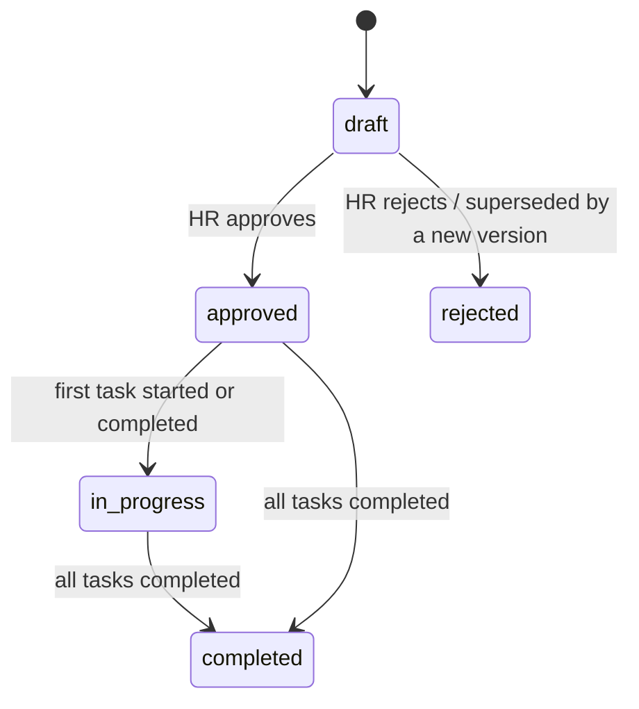
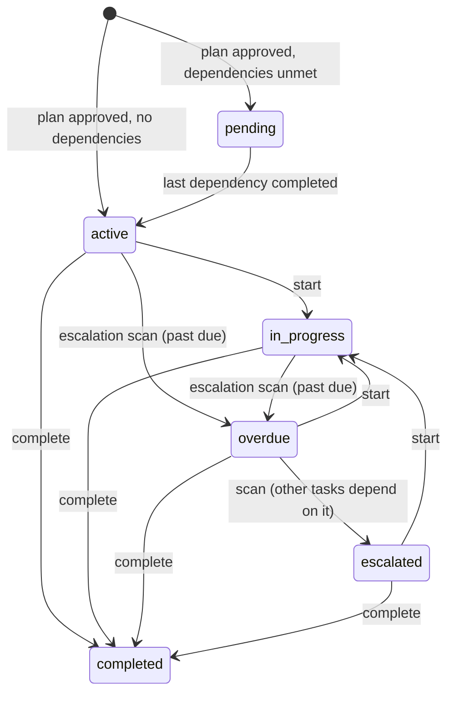

# Architecture

## Layers

| Layer | Responsibility | Location |
|---|---|---|
| Routes | Wire paths, role guards (`requireRole`), Zod validation | `backend/src/routes` |
| Controllers | Thin: parse request, call a service, respond | `backend/src/controllers` |
| Services | Business rules: orchestration, rules engine, dependency graph, escalation, task lifecycle | `backend/src/services` |
| AI | Sanitizer, Gemini client, embeddings, RAG, prompts, guardrails, checklist generator, chat assistant | `backend/src/ai` |
| Harness | Audit logger, observability, fallback handler | `backend/src/harness` |
| Data | Drizzle schema, migrations, all SQL (`db/queries`), seed | `backend/src/db` |
| Middleware | Clerk auth, validation, rate limits, request logging, error shape | `backend/src/middleware` |
| Frontend | Pages, components, TanStack Query hooks, API wrapper that attaches the Clerk token | `frontend/src` |

Rule of thumb: controllers never touch SQL, services never touch `req`/`res`, and only `db/queries` (plus a few raw reads in `stats`) talk to Postgres.

## Data flow: new hire to approved plan

1. `POST /api/employees` (HR): validate with Zod, insert the employee, audit `employee_created`.
2. `orchestrator.generatePlan`:
   1. **Rules**: `getRequiredTasks({ role, location, department })` returns the mandatory tasks. Unknown role or location yields the generic baseline, every task flagged for review.
   2. **Sanitize**: role, department and location are cleaned. Injection-looking values are replaced by `unspecified` and audited. The name and email are never sent.
   3. **RAG**: query `onboarding requirements for {location} {role} {department}`, filter `location_scope IN (country scope, global)`, cosine search with pgvector (`<=>`), top K.
   4. **Gemini** in JSON mode with a response schema, temperature 0.1, prompt version recorded.
   5. **Guardrails** (`validateAiOutput`): strip fences, parse, Zod-validate each task, drop invalid ones. More than 30% invalid, an invalid root or no valid tasks means one **retry with a correction prompt** that includes the validation error; still invalid means **fallback**.
   6. **Merge**: rule tasks are authoritative and always kept. A matching AI task only enriches the description, citation and confidence; extra AI tasks are added with `source = ai`. Legal-looking tasks always get `requires_review`.
   7. **Compliance check**: compare against the mandatory list; missing tasks are added and flagged.
   8. **Validate the dependency graph** (Kahn's algorithm), persist plan (`draft`) and tasks, write `ai_checklist_generated` with model, prompt version, tokens, latency, confidence and policies retrieved.
3. HR reviews, edits, confirms flagged tasks and approves. Approval is refused (409) while a `requires_review` task below 0.3 confidence is unconfirmed or the graph has a cycle.
4. On approval, tasks without unmet dependencies become `active`, the employee becomes `onboarding`, and the tasks become visible to IT/manager/employee.

## Harness components

| Component | What it guarantees |
|---|---|
| `sanitizer.js` | Length cap, control/tag/role-marker stripping, injection pattern detection. Profile fields are wrapped in `<user_data>`; chat injection is refused and audited. |
| `guardrails.js` | Zod schema for tasks and chat answers, bounded offsets and priorities, rejected items logged, chat citations verified against retrieved chunks (fabricated ones dropped). |
| `complianceChecker.service.js` | The plan can never be missing a mandatory task. |
| `fallbackHandler.js` | Gemini timeout, quota, error, malformed JSON or schema failure produces a rules-only plan, a `llm_failure` escalation and `fallback_plan_generated` audit. `FORCE_LLM_FAILURE=true` or `?simulate=failure` demonstrates it. |
| `auditLogger.js` | Insert-only helper plus a Postgres trigger that raises on UPDATE/DELETE of `audit_log`. |
| `observability.js` | One `llm_metrics` row per call (latency, tokens, success, confidence). `success` is updated after validation, so it means usable output, not just HTTP 200. |

## Confidence handling

- Every task has a confidence in [0, 1]. Rule tasks start at 1 (0.45 when the role or location is unknown, 0.6 in a fallback plan). When the AI matches a rule task the two are averaged.
- Badge colours: green at least 0.8, yellow 0.5 to 0.8, red below 0.5.
- Below 0.5 the task is flagged for review. Below 0.3 it needs explicit confirmation before approval and raises a critical `low_confidence_review` escalation.

## Chat pipeline

sanitize (refuse on injection) → embed question → retrieve top 5 (scope: employee's location + global) → last 5 messages as context → Gemini with a strict system prompt and `<user_question>` delimiter → Zod validate → verify citations → if no verifiable citation or confidence below 0.3 or the exact refusal sentence, mark `escalated` (UI shows "Contact HR about this question", unanswered question is audited as `chat_unanswered`). Gemini failure returns a friendly "assistant unavailable" message.

## State machines

Plan lifecycle:

Task lifecycle (start/complete are user actions; moves to `active`, `overdue` and `escalated` are made by the system):

Starting or completing a task whose dependencies are incomplete returns 409 with `details.blockedBy`.

## Escalation triggers

| Trigger | Result |
|---|---|
| Task past due | status `overdue`, warning `task_overdue` |
| Overdue task other tasks wait on | status `escalated`, critical `blocker_overdue` |
| Draft task or plan with confidence below 0.3 awaiting review | critical `low_confidence_review` / `low_confidence_plan` |
| Background check more than 48h overdue | critical `background_check_overdue` |
| Start in fewer than 5 days and more than 30% of tasks incomplete | critical `start_date_urgency` (visible to HR and the manager) |
| LLM generation failed | warning `llm_failure` with the fallback plan |

Escalations are de-duplicated per task and type while open. The scan runs on `ESCALATION_CRON`, after every task status update, and on demand (`POST /api/escalation/scan`).

## Data scoping (enforced in SQL)

| Role | Employees | Plans and tasks | Chat | Escalations |
|---|---|---|---|---|
| hr | all | all, including drafts | any employee | all |
| manager | `manager_clerk_id = caller` | approved plans of their team | their team | their team |
| employee | own record | own approved plan only | own | none |

Draft and rejected plans are invisible to non-HR callers (the employee list reports `preparing`).
