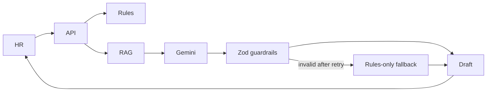

# Employee Onboarding Orchestrator: 5 slides

## Slide 1: Problem and value

- Onboarding is split across HR, IT, Finance and managers; checklists are generic and tasks slip.
- Legal paperwork differs by country: India (PAN, Aadhaar, PF/UAN), US (W-4, I-9, SSN), Canada (SIN, TD1), UK (right-to-work, P45/NI).
- Nobody sees what is late until day one.
- **Value:** a personalised, policy-grounded plan in seconds, approved by a human, tracked automatically, with a chatbot that only answers from policy.
- Impact figures (targets, not measured): fewer day-one blockers, less HR time per hire, faster time to first contribution.

## Slide 2: Workflow and demo

1. HR adds a hire (role, location, start date).
2. Rules produce mandatory tasks; RAG + Gemini add context; guardrails validate; compliance check fills gaps.
3. Draft plan with confidence, flags and citations.
4. HR edits, confirms flagged tasks, approves.
5. Tasks go to HR, IT, manager and new hire; dependencies unlock work.
6. Escalations catch late or risky items; new hire chats with the policy assistant.

Live demo: add "Priya Sharma, Software Engineer, Bangalore" and walk through the flow.

## Slide 3: Architecture and AI harness

- React + Vite, Express, Neon Postgres + pgvector, Clerk, Gemini.
- **Harness:** sanitizer, JSON-mode schema, Zod guardrails, compliance checker, fallback handler, audit trail (DB-enforced immutability), observability.
- **Rules first:** the model can add and enrich, never remove or reschedule mandatory tasks.
- Role scoping enforced in SQL, not only in the UI.

## Slide 4: Safety and evaluation

What the system does today:
- Every LLM output is validated; invalid tasks are rejected and logged.
- Tasks below 0.3 confidence block approval until a human confirms them.
- Chat refuses out-of-scope questions, drops fabricated citations and refuses prompt injection.
- Failures degrade to a template plan instead of an error.

Evaluation (`npm run eval`, 14 scenarios): **paste the real output of your run here.** Report accuracy, out-of-scope refusal rate, average latency and the share of checklist scenarios that ran in AI mode. Do not quote numbers that were not produced by your own run against your Gemini key.

| Metric | Result |
|---|---|
| Scenarios passed | _from `npm run eval`_ |
| Out-of-scope refusal rate | _from `npm run eval`_ |
| Checklist scenarios in AI mode | _from `npm run eval`_ |
| Average latency | _from `npm run eval`_ |

## Slide 5: Future improvements and business impact

- Human-in-the-loop feedback: learn from which AI tasks HR edits or deletes (already tracked as "AI tasks edited by HR").
- Real IT/Finance integrations (ticketing, HRIS) instead of manual completion.
- Per-company policy upload, role scopes in retrieval, and re-ranking.
- Notifications (email/Slack) for escalations; multi-language chat.
- Stronger injection defences (classifier) and a self-hosted model option for data residency.
- **Estimated business impact (targets to validate in a pilot):** reduce HR coordination effort per hire, reduce first-week blockers, shorten time-to-productivity. These are estimates, not measured results.
